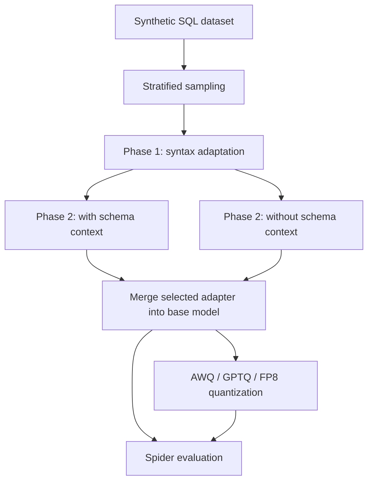

# Mistral NeMo Text-to-SQL

Sequential QLoRA fine-tuning of **Mistral NeMo 12B Instruct** for generating SQL from natural-language questions, followed by model merging, quantization, and Spider evaluation.

The project separates SQL syntax adaptation from Spider-specific refinement. Phase 1 trains on a stratified sample of synthetic SQL examples. Phase 2 continues the Phase 1 adapter in one of two variants: with database schema context, or with only the database ID as context. The resulting model can be compared with the base model and AWQ, GPTQ, and FP8 variants.

The implementation includes distributed training, validated checkpoint recovery, experiment tracking, resource histories, and prediction artifacts that preserve the identity and order of evaluation examples. The instructions below run each script independently.

## Workflow



Choose one Phase 2 variant for a single experiment. To compare both variants, give them distinct output directories and downstream model repository names.

| Stage | Entry point | Inputs | Outputs |
| --- | --- | --- | --- |
| Prepare Phase 1 data | `scripts/prepare_dataset.py` | Synthetic SQL `train` and `test` splits | Stratified Hugging Face dataset with `train` and `validation` splits |
| Phase 1 | `scripts/text-to-sql-phase1.py` | Base model and prepared synthetic dataset | LoRA adapter, full training checkpoints, training metrics |
| Phase 2 with context | `scripts/text-to-sql-phase2-w-context.py` | Phase 1 adapter and schema-augmented Spider rows | Refined adapter and validation prediction artifacts |
| Phase 2 without context | `scripts/text-to-sql-phase2-wo-context.py` | Phase 1 adapter and raw Spider rows | Refined adapter and validation prediction artifacts |
| Merge | `scripts/merge_model.py` | Base model and selected Phase 2 adapter | Local merged model and Hugging Face model publication |
| Quantize | `scripts/quantization.py` | Published merged model and calibration split | Compressed model directories and Hugging Face publications |
| Final evaluation | `scripts/final_eval.py` | Configured models, test rows, SQLite databases, and schemas | Prediction exports, Spider scores, W&B tables, resource histories |
| Score existing predictions | `scripts/evaluation.py` | Gold rows, ordered SQL predictions, databases, and schemas | JSON scores and per-example diagnostics |

Both Phase 2 scripts load the existing Phase 1 adapter as trainable. They continue that adapter rather than initializing a separate LoRA adapter.

## Repository layout

```text
Nemo-text-to-sql/
├── configs/
│   ├── base.yaml                 # Shared account, tracking, seed, and SQL settings
│   ├── fine_tune/                # Dataset preparation, training, and smoke configs
│   ├── merge_model/              # Merge settings and structured schema
│   ├── quantization/             # Calibration and compression settings
│   └── final_eval/               # Model comparisons and evaluation paths
├── docs/                         # Implementation and operational guides
├── scripts/                      # Independent executable stages
├── utils/
│   ├── checkpoint.py             # Attempt discovery, compatibility, completion
│   ├── resume.py                 # Training RNG restoration and DDP resize support
│   ├── evaluation_artifacts.py   # Sample manifests and prediction exports
│   ├── sql_execution.py          # Bounded SQLite execution worker
│   ├── resources.py              # CPU, memory, GPU, and timing histories
│   ├── hub.py                    # Hub loading, publication, and retry helpers
│   └── ...
├── .secrets.env.example          # Placeholder credential template
├── .gitignore
├── environment.yaml             # Linux reference environment
└── README.md
```

## Environment and installation

### Requirements

- Linux with an NVIDIA GPU and a CUDA-compatible driver.
- Conda or Miniconda for the supplied environment export.
- Enough GPU and host memory for the selected stage, sequence length, and batch size. Training uses 4-bit model loading; merging and quantization load larger representations and have different memory requirements.
- Persistent disk capacity for base-model downloads, optimizer state, adapters, merged weights, compressed variants, and caches.
- Access to the configured Hugging Face model/dataset repositories and, for online tracking, a W&B account.

The training configurations use BF16 and FlashAttention 2. The GPU and installed PyTorch/CUDA/FlashAttention builds must support those settings. The current training defaults should not be assumed to fit a smaller GPU without adjustment.

### Create the environment

```bash
git clone https://github.com/NBAmine/Nemo-text-to-sql.git
cd Nemo-text-to-sql

conda env create --file environment.yaml
conda activate nemo_text_to_sql

```

### Main dependency versions

These are the versions pinned in `environment.yaml`, rather than minimum version requirements.

| Dependency | Pinned version | Role |
| --- | --- | --- |
| Python | `3.13.17` | Runtime |
| PyTorch | `2.12.0` | GPU computation and distributed training |
| Transformers | `5.17.0` | Model/tokenizer loading and generation |
| TRL | `1.16.0` | Supervised fine-tuning with `SFTTrainer` |
| PEFT | `0.21.2` | LoRA adapter training and merging |
| bitsandbytes | `0.50.2` | 4-bit NF4 model loading for QLoRA |
| Accelerate | `1.15.0` | Training and device-management support |
| Datasets | `5.1.0` | Dataset loading and transformations |
| FlashAttention | [`2.8.3+cu132torch2.12`](https://github.com/mjun0812/flash-attention-prebuild-wheels/releases/download/v0.9.17/flash_attn-2.8.3+cu132torch2.12-cp313-cp313-linux_x86_64.whl) | Prebuilt attention-kernel wheel used by the training stack |
| LLM Compressor | `0.14.0.1` | AWQ, GPTQ, and FP8 compression |
| compressed-tensors | `0.19.0` | Compressed model serialization and loading |
| Hugging Face Hub | `1.33.0` | Model/dataset downloads and publication |
| Hydra | `1.3.8` | Configuration composition and CLI overrides |
| OmegaConf | `2.3.1` | Structured configuration and interpolation |
| W&B | `0.31.0` | Experiment tracking and artifact logging |
| Typer | `0.27.3` | Prediction-scoring command-line interface |

Resource monitoring additionally uses psutil and NVIDIA NVML bindings.

### FlashAttention wheels

The [FlashAttention wheel used for this project](https://github.com/mjun0812/flash-attention-prebuild-wheels/releases/download/v0.9.17/flash_attn-2.8.3+cu132torch2.12-cp313-cp313-linux_x86_64.whl) targets **Linux x86-64, CPython 3.13, PyTorch 2.12, CUDA 13.2, and FlashAttention 2.8.3**. If the pinned build is unavailable from your package index, install the wheel directly in the activated environment:

```bash
python -m pip install "https://github.com/mjun0812/flash-attention-prebuild-wheels/releases/download/v0.9.17/flash_attn-2.8.3+cu132torch2.12-cp313-cp313-linux_x86_64.whl"
```

For another platform or version combination, use the community-maintained [FlashAttention prebuilt wheel selector](https://mjunya.com/flash-attention-prebuild-wheels/). It provides filters for platform, Python, PyTorch, CUDA/ROCm, and package version, along with download links and installation commands for available wheels. Select a wheel matching the environment you intend to run; the project wheel above is specific to its listed combination.

Training uses NCCL. Multi-GPU Phase 2 evaluation also needs Gloo for coordination while rank zero generates and scores predictions.

## Credentials and configuration

### Credentials

Copy the placeholder template, replace its values locally, and export them into the shell that launches the scripts:

```bash
cp .secrets.env.example .secrets.env
# Edit .secrets.env with your own HF_TOKEN and WANDB_API_KEY.
source .secrets.env
```

The standalone scripts read environment variables; they do not automatically source this file. Dataset preparation and merging require `HF_TOKEN`. Training defaults, quantization, and final evaluation also use `WANDB_API_KEY`. The Hugging Face token needs access to input repositories and write permission for the output repositories you select.

### Hydra

Run commands from the repository root. Relative input and output paths are interpreted in that context; `hydra.job.chdir` is disabled in the shared configuration.

The configs retain the author's account names, model IDs, and dataset IDs. Changing `hub.user` updates interpolated repository names, but does not replace literal IDs such as some `dataset.id` values (which is publicly available at HuggingFace) or every final-evaluation model ID. Check the resolved configuration and override those fields explicitly when using another account.

## Dataset requirements

### Hugging Face datasets

| Consumer | Required splits | Required columns before formatting |
| --- | --- | --- |
| Phase 1 preparation | `train`, `test` | `sql_complexity`, plus the Phase 1 columns below |
| Phase 1 training | `train`, `validation` | `sql_context`, `sql_prompt`, `sql` |
| Phase 2 with context | `train`, `validation` | `context`, `question`, `query`, `db_id` |
| Phase 2 without context | `train`, `validation` | `question`, `query`, `db_id` |
| Quantization | Configured split, default `calibration` | `context`, `question`, `query` |
| Final evaluation | `test` | `context`, `question`, `query`, `db_id` |

Phase 1 preparation defaults to `gretelai/synthetic_text_to_sql`. It samples each SQL-complexity category independently in each source split using deterministic seeds and configurable rates, then renames the sampled `test` split to `validation` before uploading. It does not prepare the Phase 2, calibration, or final-evaluation datasets.

The context-aware training, calibration, and final-evaluation defaults reference prepared datasets in the author's namespace.

The formatting used by the model is:

```text
Context: <database schema, synthetic SQL context, or database ID>
Question: <natural-language question>
Answer: <reference SQL during training>
```

The Phase 2 comparison changes the context field: the context-aware variant uses `context`, while the other variant uses `db_id`. Both retain the question and target SQL.

### Local Spider databases

Hugging Face rows do not replace the SQLite files needed for execution scoring. Download the [spider.zip](https://yale-lily.github.io/spider) file and unzip it in the project root:

```text
spider/spider_data/
├── tables.json
├── database/
│   └── <db_id>/<db_id>.sqlite
├── test_tables.json
└── test_database/
    └── <db_id>/<db_id>.sqlite
```


## Run the scripts

From the repository root, export `PYTHONPATH` once in each shell before launching the scripts:

```bash
export PYTHONPATH="$PWD${PYTHONPATH:+:$PYTHONPATH}"
```

This adds the repository root to Python's import path while preserving existing entries, so direct script and `torchrun` launches can import `configs` and `utils`.

The commands below use two GPUs for training as an example. Adjust the worker count and batch sizes to your hardware. The training entry points read the distributed rank variables supplied by `torchrun`; use that launcher even with `--nproc_per_node=1`.

### 1. Train Phase 1

For a new experiment:

```bash
torchrun --standalone --nnodes=1 --nproc_per_node=2 \
  scripts/text-to-sql-phase1.py \
  resume.mode=fresh
```

The script formats the prepared synthetic examples, loads the base model in 4-bit NF4, and trains a LoRA adapter. Defaults include BF16 computation, LoRA rank 32 / alpha 64, a 2,048-token maximum length, five epochs, and a learning rate of `1e-4`. These are configured values, not a hardware sizing guarantee. Early stopping can end training before all epochs complete.

Use `resume.mode=fresh` only when starting a new training attempt. For an interrupted run, use `resume.mode=auto`.

### 2. Train one Phase 2 variant

Both commands load the Phase 1 adapter specified by `hub.phase1_adapters_repo_id` in their Hydra configuration. The default is the configured Hugging Face Phase 1 repository.

With schema context:

```bash
torchrun --standalone --nnodes=1 --nproc_per_node=2 \
  scripts/text-to-sql-phase2-w-context.py
```

Or without schema context:

```bash
torchrun --standalone --nnodes=1 --nproc_per_node=2 \
  scripts/text-to-sql-phase2-wo-context.py
```

The without-context example uses the configured `xlangai/spider` dataset.

Both variants default to a learning rate of `1e-5`. Their validation callback generates SQL and computes Spider scores against the local databases. In distributed training, all ranks coordinate the evaluation hook while global rank zero performs generation, scoring, and artifact logging.

### 3. Merge the selected Phase 2 adapter

The default Hydra configuration merges the with-context Phase 2 adapter from Hugging Face:

```bash
python -m scripts.merge_model
```

The merge script loads the unquantized base model, attaches the selected adapter, merges its weights, saves the model and tokenizer locally, and uploads the saved folder.

### 4. Quantize the published merged model

```bash
python -m scripts.quantization
```

The YAML default selects all calibration rows. Each selected method is processed in sequence, saved under `artifacts/quantized-models/<method>/`, and published to a repository with the corresponding `-awq`, `-gptq`, or `-fp8` suffix.

For cooperating calibration workers on n GPUs:

```bash
torchrun --standalone --nnodes=1 --nproc_per_node=n --max-restarts=0 scripts/quantization.py
```

Distributed quantization partitions the calibration samples across workers and uses CPU-backed weight offloading. It requires at least one selected calibration sample per worker.

### 5. Compare the base, merged, and compressed models

```bash
python -m scripts.final_eval
```

The configured comparisons include the base instruct model, merged model, and all three compressed variants.

For a smaller evaluation pass, use `dry_run=true`. This still loads the selected models, accesses datasets and databases, and performs tracking/artifact operations; it is not a configuration-only check. Use separate W&B dataset artifact names for independent datasets or subsets, for example `wandb.ds_artifact_name=spider-test-experiment-001`.

## Checkpoint recovery

Checkpoint discovery is shared by the three training scripts in `utils/checkpoint.py`. It restores full training state through the Trainer, including model/adapter weights, optimizer, scheduler, and RNG state; loading an adapter alone is not equivalent to resuming training.

| Setting | Behavior |
| --- | --- |
| `resume.mode=auto` | Resume discovered compatible state, or create a new attempt after confirming no state exists |
| `resume.mode=required` | Require existing resumable state or a recognized completed attempt; fail if none is found |
| `resume.mode=fresh` | Start a new attempt without loading earlier training state |
| `resume.source=auto` | Inspect local and configured Hub state; compare progress only when identities match |
| `resume.source=local` | Inspect local state only |
| `resume.source=hub` | Inspect the configured Hugging Face checkpoint repository only |

The training defaults use `auto` for both mode and source. A missing or inaccessible Hub repository is an error rather than proof that no checkpoint exists. For a genuinely new experiment, use `fresh`; for local recovery without Hub discovery, select `source=local`.

### Local recovery example

Relaunch with the same training, dataset, tracking-identity, and adapter-source settings. Replace `resume.mode=fresh` with the recovery policy and select the existing output root:

```bash
torchrun --standalone --nnodes=1 --nproc_per_node=2 \
  scripts/text-to-sql-phase1.py \
  resume.mode=required \
  resume.source=local
```

The resolver looks in the root and its immediate `attempt-*` directories. If exactly one attempt contains checkpoint/completion state, it selects that attempt. When more than one exists, set `paths.adapter_output_path` to the intended `attempt-<id>` directory explicitly.

Within an attempt it selects the highest-numbered `checkpoint-N`, then validates the files, metadata, and compatibility contract. An incomplete or incompatible latest checkpoint causes an error; the resolver does not silently fall back to an older checkpoint or restart training. Legacy checkpoints without the required attempt metadata are rejected.

Recovery keeps the original training attempt ID, output directory, and saved W&B run identity. A Hub checkpoint is copied into a local attempt directory with its original ID before training continues. If local and Hub candidates refer to different attempts or tracking identities, explicitly select a source.

Completed training is recognized through completion/state evidence and skipped. A successful final export is recorded in `training_completed.json`; verify that record and the adapter/tokenizer files before using an attempt as a downstream input. Reaching the saved maximum step count alone does not prove that final exports completed successfully.

### Worker-count changes

The YAML configs enable `resume.allow_world_size_change`. Supported DDP-to-DDP resizing still requires compatible settings and preservation of the effective batch size:

```text
effective batch size = per-device batch size × gradient accumulation × worker count
```

### Small training smoke run

```bash
torchrun --standalone --nnodes=1 --nproc_per_node=1 \
  scripts/text-to-sql-phase1.py \
  fine_tune/smoke_test=enabled
```

The smoke group caps dataset sizes and training steps, and starts a fresh attempt under the phase's smoke output root. The smoke configuration enables online W&B tracking and Hugging Face publication. Dataset/model access and a supported GPU are still required; configure `HF_TOKEN` and `WANDB_API_KEY` before running.

Training also supports `wandb.mode=offline`. These Hydra tracking modes apply to training; quantization and final evaluation have their own W&B behavior.

## Outputs and observability

| Location | Contents |
| --- | --- |
| `artifacts/adapters/adapter-<phase>/attempt-<id>/` | Checkpoints, final adapter/tokenizer, training metrics, completion record |
| `artifacts/adapters/smoke-<phase>/attempt-<id>/` | Smoke-run checkpoints and adapter exports |
| `artifacts/merged_model/` | Merged model and tokenizer saved before publication |
| `artifacts/quantized-models/awq/`, `gptq/`, `fp8/` | Compressed model exports and tokenizers |
| `artifacts/evaluation/` | Dataset snapshots, sample manifests, raw predictions, scorer exports |
| `artifacts/resources/` | Per-session, per-rank resource histories and summary JSON |
| `logs/` | Rotating application logs, with rank-specific filenames for distributed runs |
| `outputs/`, `multirun/` | Hydra run metadata when created by standalone launches |
| `wandb/` | Local tracking files and offline runs |

Evaluation artifacts preserve raw model responses and stable sample identities before producing the single-line SQL format consumed by the scorer. Failed generations remain represented, so removing failures does not accidentally inflate a score. Resource histories record CPU/process memory, available GPU measurements, and stage-specific timing; W&B integration forwards selected metrics from global rank zero.

## Evaluation protocol and results

The evaluation workflow supports:

- Execution accuracy against SQLite reference results.
- Spider structural exact match and partial clause metrics.
- Scores grouped by query hardness.
- Generated SQL examples, failures, and prediction diagnostics.
- Resource and compression measurements for comparing model variants.

SQL execution uses read-only database connections in a separate worker with query timeouts and result-size limits. The worker is reused across a scoring pass and replaced after a query timeout. This bounds execution for evaluation; successful execution alone does not establish SQL correctness.

## Running on AWS

AWS deployment is a planned extension. This repository does not currently include a tested AWS Batch deployment, Docker image definition, or infrastructure-as-code setup.
