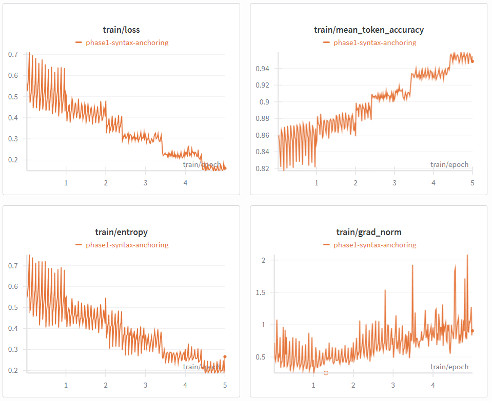
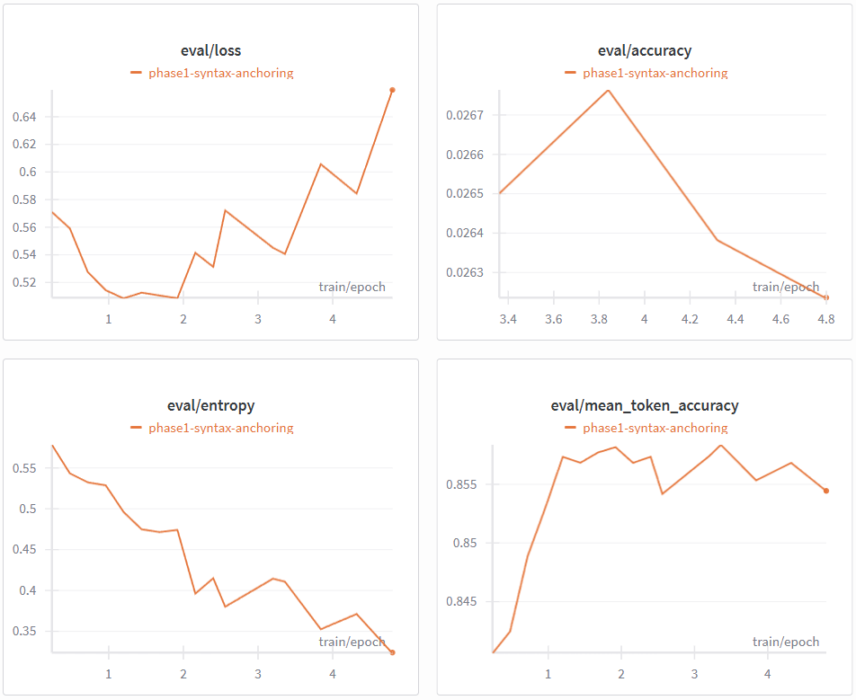
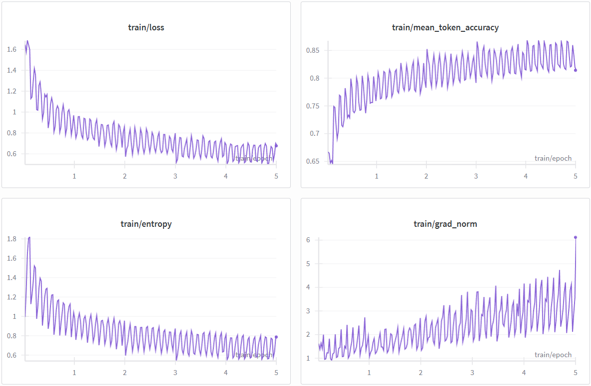
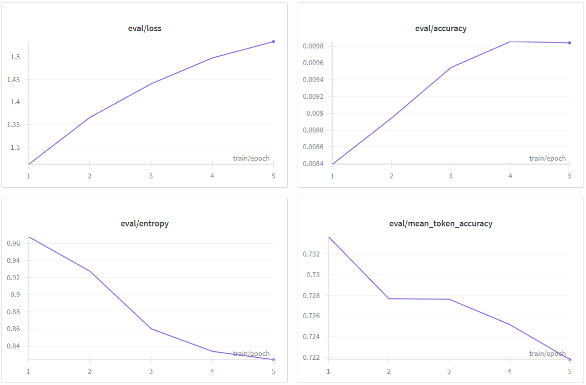

# Project Report: Incremental Fine-Tuning for Text-to-SQL

  
  &nbsp;
  
   
  
  &nbsp;
  

## Project Overview
This project focuses on fine-tuning the **Mistral NeMo 12B Instruct** model to transform natural language questions into executable SQL queries. We adopted a two-phase incremental learning strategy to build a robust model capable of handling both syntax and complex relational logic.

## Core Library Versions

Based on the project requirements and implementation, the following key libraries and their specific versions were used to ensure compatibility with the Mistral NeMo 12B model and the x2 NVIDIA T4 hardware provided by Kaggle:

| Library | Version | Purpose |
| :--- | :--- | :--- |
| **transformers** | 4.57.6 | Core model loading and tokenization |
| **peft** | 0.18.1 | Parameter-Efficient Fine-Tuning (LoRA) |
| **trl** | 0.27.0 | SFTTrainer for supervised fine-tuning |
| **bitsandbytes** | 0.49.1 | 4-bit NF4 quantization |
| **accelerate** | 1.12.0 | Hardware acceleration and memory management |
| **torch** | 2.8.0+cu126 | Deep learning framework with CUDA support |
| **datasets** | 4.4.2 | Data loading (Spider and GretelAI) |
| **wandb** | 0.24.0 | Experiment tracking and metric logging |
| **huggingface-hub** | 0.36.0 | Model checkpointing and version control |

## Technical Configuration

The following parameters were utilized for the QLoRA fine-tuning process across both phases:

### Quantization (bitsandbytes)
* **Method:** 4-bit NormalFloat (NF4)
* **Compute Dtype:** `torch.float32` (Required for stability on T4 GPUs)
* **Double Quantization:** Enabled (`bnb_4bit_use_double_quant=True`)

### PEFT / LoRA
* **Rank (r):** 16
* **Alpha:** 32
* **Target Modules:** `["q_proj", "k_proj", "v_proj", "o_proj", "gate_proj", "up_proj", "down_proj"]`
* **Dropout:** 0.05
* **Task Type:** Causal LM

### Training Arguments (SFTConfig)
* **Learning Rate:** $1 \times 10^{-4}$ (Phase 1) | $1 \times 10^{-5}$ (Phase 2)
* **Effective Batch Size:** 16 (Batch size 1 $\times$ 16 Gradient Accumulation steps)
* **Optimizer:** `paged_adamw_8bit`
* **Precision:** `fp16=True` (BFloat16 disabled for hardware compatibility)
* **Gradient Checkpointing:** Enabled
* **Max Length:** 1024 tokens

### SFTTrainer & Logic
* **Validation:** Integrated custom `SQLSampleCallback` for real-time inference logging.
* **T4 Compatibility Fix:** Explicit conversion of all adapter weights to `float32` post-initialization to prevent mixed-precision crashes.
* **Saving Strategy:** Hub-synced checkpoints with a limit of 2 to optimize disk space.

## Phase 1: Syntax Anchoring
**Notebook:** `text-to-sql-phase1.ipynb`

### Objective
The goal was to establish a solid foundation in SQL syntax and basic schema linking.

### Methodology
- **Model:** mistralai/Mistral-Nemo-Instruct-2407 (4-bit quantization via BitsAndBytes).
- **Dataset:** 10,000 samples from `gretelai/synthetic_text_to_sql`.
- **Technique:** QLoRA fine-tuning (Rank 16, Alpha 32).
- **Optimization:** Training with a learning rate of $1 \times 10^{-4}$ using the `SFTTrainer`.

### Results

- **Loss Convergence:** The training loss decreased steadily, indicating the model successfully learned the structural patterns of SQL.
- **Outcome:** The model became highly proficient at generating syntactically correct queries (e.g., proper use of `SELECT`, `FROM`, `WHERE`) for single-table scenarios.

## Phase 2: Logical Alignment
**Notebook:** `text-to-sql-phase2.ipynb`

### Objective
Building upon Phase 1, this phase aimed to improve the model's ability to handle complex queries involving multi-table joins and aggregations.

### Methodology
- **Starting Point:** Loaded the LoRA adapters saved at the end of Phase 1.
- **Dataset:** ~7,000 samples from the **Spider** dataset (known for its cross-domain complexity).
- **Refinement:** Lower learning rate ($1 \times 10^{-5}$) to fine-tune the weights without destroying the syntax knowledge from Phase 1.

### Results & Interpretation

- **Performance:** While the model showed an understanding of complex clauses like `GROUP BY` and `JOIN`, we observed a "bottleneck" in accuracy.
- **Key Finding:** The model struggled to correctly identify column names and table relationships because the training prompt lacked the underlying database schema. Without the `CREATE TABLE` context, the model was forced to "hallucinate" schema details.

## Future Work: Context-Aware Training
To overcome the limitations identified in Phase 2, the next iteration will focus on **Schema-Augmented Generation**